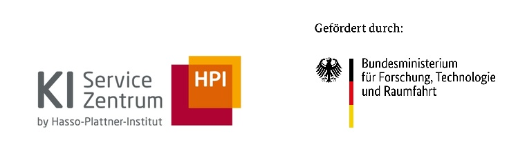
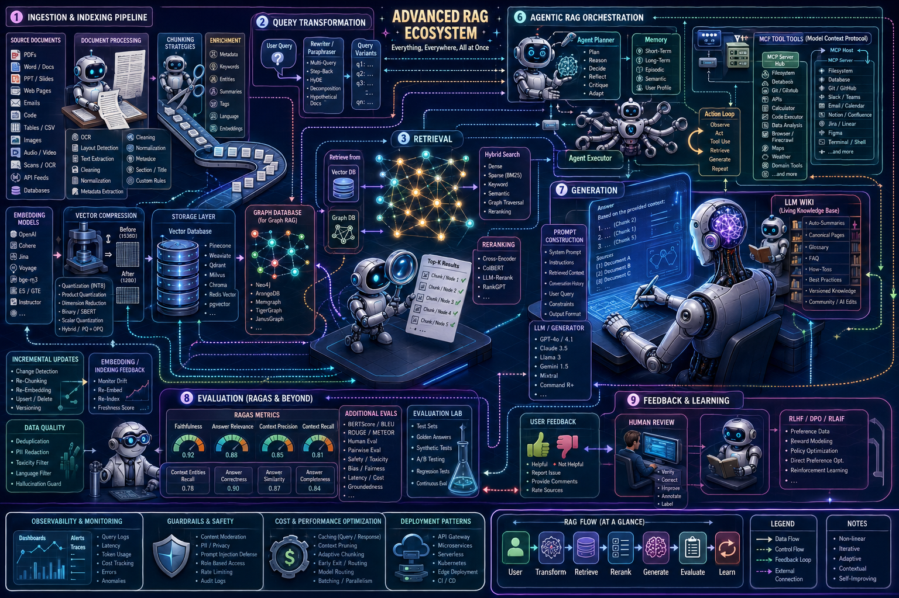
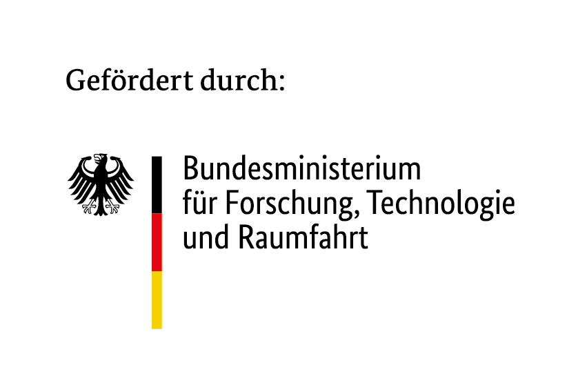

<p align="center">
  
</p>

# workshop-rag-forum

A forum for monthly meetings centred around **Retrieval-Augmented Generation (RAG)**.
Each meeting explores a different topic (embedding models, vector compression,
retrieval strategies, evaluation, etc.).

## The RAG forum at a glance

<p align="center">
  
</p>

A RAG system is a short pipeline, but almost every stage hides a knob worth turning.
Each meeting we pick one, dig in together, and compare problems, stacks, and ideas.


## Repository layout

```
01_event/                 # one folder per meeting: YYMMDD-topic/
  260615-turbovec/        # vector compression; standalone scripts + pyproject.toml
  260901-rag-bias/        # retrieval bias; packages, tests + pyproject.toml
    src/workshop_rag_forum/   # a small RAG pipeline: chunking, embedding, store, retrieval, generation
    src/rag_bias/             # the study on top of it: corpus, metrics, DetGreedy, `rag-bias` CLI
  261102-llm-wiki/        # LLM wiki instead of RAG, with starter skills; no code
devtools/                 # lint script behind `make lint` and CI
data/                     # corpora, indexes & results (gitignored)
.env_example              # copy to .env and fill in your endpoint + key
```

The repository is a [uv workspace](https://docs.astral.sh/uv/concepts/projects/workspaces/):
the root holds no code, and every meeting with code is a member with its own
`pyproject.toml` and dependencies. `make install` (`uv sync --all-packages --all-extras`)
installs everything into one `.venv`.

## Meetings

| Date     | Topic     | Folder                        | Summary                                              |
|----------|-----------|-------------------------------|------------------------------------------------------|
| 26-06-15 | turbovec  | [`01_event/260615-turbovec/`](01_event/260615-turbovec/) | Illustrating turbovec vector compression vs. a float32 embedding baseline |
| 26-09-01 | rag-bias  | [`01_event/260901-rag-bias/`](01_event/260901-rag-bias/) | Bias im RAG: measuring A = p_k/p₀ across occupations, with a realistic and a 50/50 corpus |
| 26-11-02 | llm-wiki  | [`01_event/261102-llm-wiki/`](01_event/261102-llm-wiki/) | Das KISZ-Wiki: why the team keeps its own knowledge in an LLM-maintained wiki instead of RAG; slides and generic skills to start your own wiki |

## Documentation

- [ARCHITECTURE.md](ARCHITECTURE.md): how the repository and the pipeline are
  organised. Module map, the `attrs` contract, the Protocol seams, on-disk layout.
- Each meeting folder has its own README with how to run it and what comes out.

## Setup

See [installation.md](installation.md) for installing uv and Python, and
[development.md](development.md) for development workflows. Copy `.env_example` to
`.env` and fill in your endpoint, key and model names before running a meeting's
scripts.

## References

- [AI Service Centre Berlin Brandenburg (KI-Servicezentrum)](https://hpi.de/ki-servicezentrum/)

## License

This project is licensed under the [MIT License](LICENSE).

---

## Acknowledgements


The [AI Service Centre Berlin Brandenburg](http://hpi.de/kisz) is funded by the [Federal Ministry of Research, Technology and Space](https://www.bmbf.de/) under the funding code 01IS22092.
